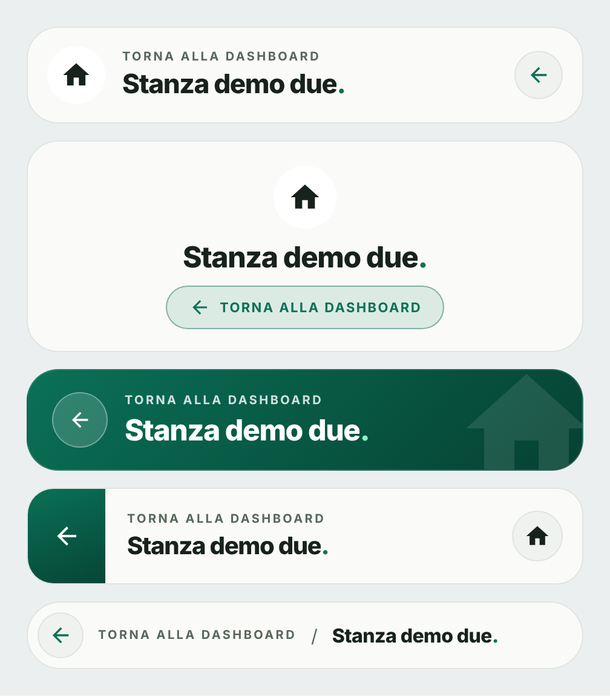
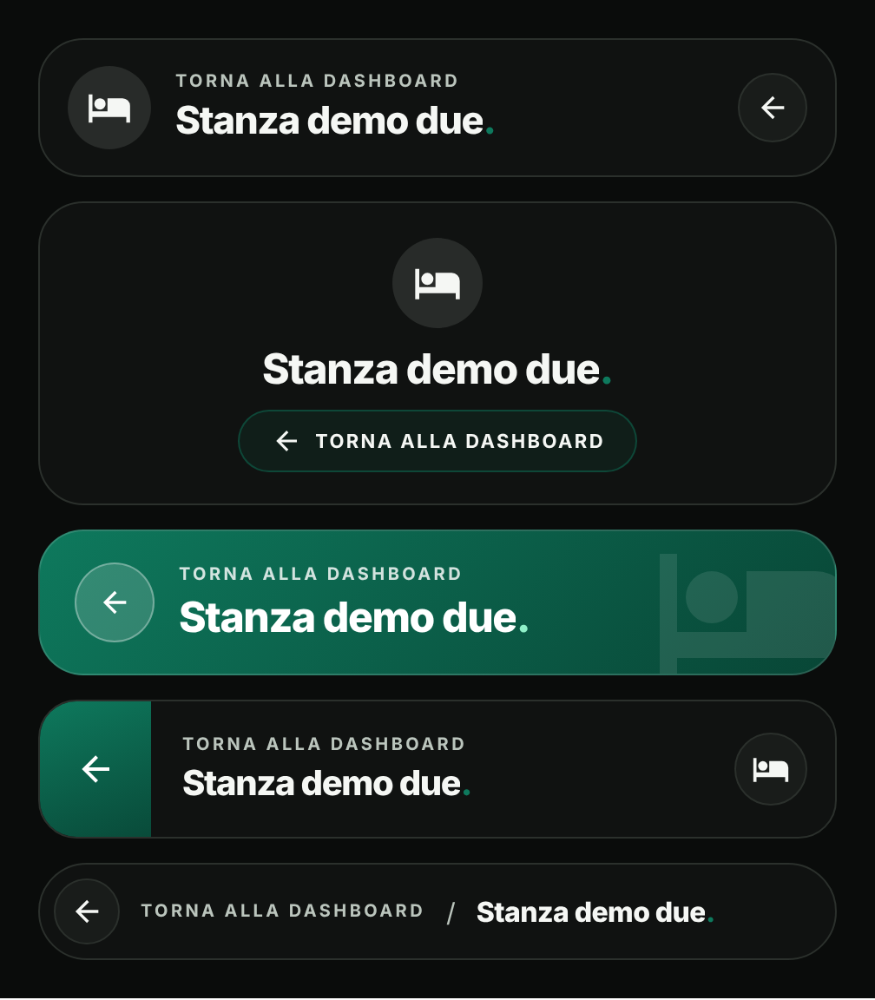

# Home Return Card

[](https://my.home-assistant.io/redirect/hacs_repository/?owner=luigi-regolo&repository=home-return-card&category=plugin)
[](https://github.com/luigi-regolo/home-return-card/releases/latest)
[](LICENSE)
[](https://github.com/luigi-regolo/home-return-card/stargazers)

## Overview

**Home Return Card** is a navigation card for Home Assistant dashboards, designed with a minimalist interface inspired by the Edera Light and Dark visual styles.

It does one thing: it takes you back to your main dashboard from any page. It reads the name of the page you are on, such as *Stanza demo uno* or *Stanza demo due*, and shows it with the label *Torna alla dashboard* and the icon of your dashboard, so the same card can be placed on every page.

The card only changes page: it never sends commands to your devices. It does not require a dedicated account, external services or additional libraries.

## Preview





*Previews use a fictional page name. The interface text is currently in Italian.*

## Features

- **Current page name:** Reads the name of the page you are on from the dashboard configuration. If the dashboard configuration cannot be read, the name is derived from the page address.
- **Dashboard icon:** By default the card shows the icon of your dashboard, as set in the Home Assistant sidebar, and falls back to the icon of the page. You can choose another icon.
- **Five styles:** Row with arrow, Centered, Solid emerald, Arrow panel and Slim path, selectable from the visual editor.
- **Destination of your choice:** Pick the dashboard or view to return to with the Home Assistant navigation picker. Only internal Home Assistant paths are accepted.
- **Standard or slim height:** The default size is unchanged; a slimmer version of every style can be selected.
- **Arrow of your choice:** Left arrow (default), up arrow, return, check mark or view change.
- **Customizable texts:** The label and the page title are always shown and can be changed. An optional card name, written as the small uppercase header of the other Edera cards, can be turned on; it is off by default.
- **Full width:** In the sections view the card takes the full width of the section.
- **Stable layout:** The card is drawn from what is already known when it appears, so it does not change size when the page name is loaded.
- **Visual configuration:** Configure the card through the Home Assistant dashboard editor, without writing YAML.
- **Edera appearance:** Automatic, Light and Dark themes with Home Assistant Material Design Icons.
- **Responsive layout:** A responsive interface for desktop, smartphone and tablet dashboards.

## Installation

### HACS — Custom repository

1. Open **HACS** in Home Assistant.
2. Open the menu and select **Custom repositories**.
3. Enter the repository URL:

   `https://github.com/luigi-regolo/home-return-card`

4. Select **Dashboard** as the repository type and add it.
5. Find **Home Return Card** in HACS and download it.
6. Reload the Home Assistant dashboard if necessary.
7. Add **Home Return Card** to your dashboard and configure it using the visual editor.

The repository contains `hacs.json` and the distributable JavaScript module `dist/home-return-card.js`.

### Manual installation

1. Download `dist/home-return-card.js` from the GitHub repository.
2. Copy it to the `www` directory of your Home Assistant configuration as `home-return-card.js`.
3. Open **Settings → Dashboards → Resources** in Home Assistant.
4. Add the following resource:

   `/local/home-return-card.js`

5. Select **JavaScript module** as the resource type.
6. Reload the dashboard and add the card.

If the `www` directory was just created, Home Assistant may need to be restarted before the file becomes accessible.

## Configuration and Usage

### Visual editor

Open a dashboard in edit mode, add **Home Return Card** and configure it. The editor has three sections:

- **Destinazione:** the dashboard or view the card returns to.
- **Aspetto:** style, height, arrow, label, title, optional card name, icon and theme.
- **Avanzate:** reading of the page name and icon, and a manual destination path.

### Example YAML configuration

The card can be configured entirely through the visual editor. The following example uses a fictional dashboard path:

```yaml
type: custom:home-return-card
style: row
navigation_path: /dashboard-demo
```

### Main configuration options

| Option | Description |
|---|---|
| `navigation_path` | Internal path the card returns to, for example `/dashboard-demo`. It must start with `/`. Without it, the card does nothing when tapped. |
| `style` | `row`, `centered`, `solid`, `split` or `slim`. Default: `row`. |
| `density` | `standard` or `thin` (slimmer card). Default: `standard`. |
| `arrow` | `left`, `up`, `return`, `check` or `exit`. Default: `left`. |
| `label` | Small uppercase text above the page name. Default: `Torna alla dashboard`. |
| `title` | Custom title. Leave empty to show the name of the current page. |
| `show_name` | Show the card name as a small uppercase header above the card. Default: `false`. |
| `name` | Card name shown when `show_name` is enabled. Default: `HOME RETURN CARD`. |
| `icon` | Custom icon, for example `mdi:door`. Leave empty to use the icon of the dashboard. |
| `auto_page` | Read the page name and icon from the dashboard configuration. Default: `true`. |
| `theme_mode` | `auto`, `light` or `dark`. |

## Compatibility and Requirements

- Home Assistant with support for custom JavaScript dashboard modules.
- No additional libraries, subscriptions or cloud services.

No specific minimum Home Assistant version has been independently verified or declared for this repository.

## Privacy and Security

The card only changes page: it never calls services or sends commands. It contains no telemetry, analytics, remote scripts or external assets. Destinations are limited to internal Home Assistant paths.

## Releases

See [GitHub Releases](https://github.com/luigi-regolo/home-return-card/releases) for published versions.

## Copyright & License

Copyright © 2026 luigi-regolo.

Original project created and maintained by **luigi-regolo**.

Licensed under the **GNU General Public License version 3 only (GPL-3.0-only)**.

See the [LICENSE](LICENSE) file for the complete license terms.

The software is provided without warranty to the extent permitted by applicable law.
